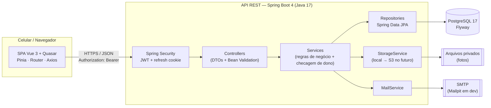
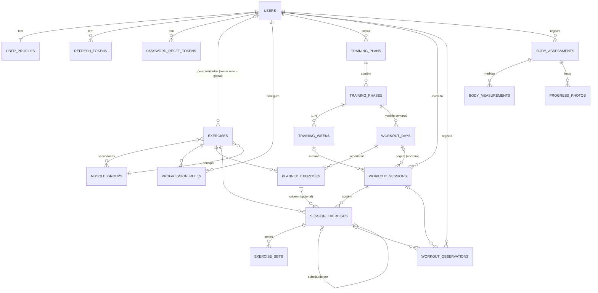
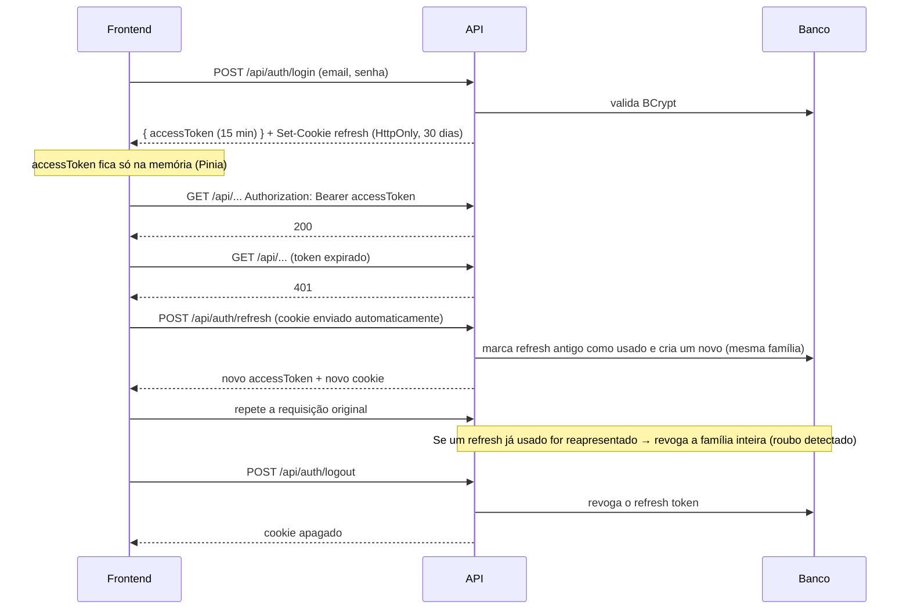
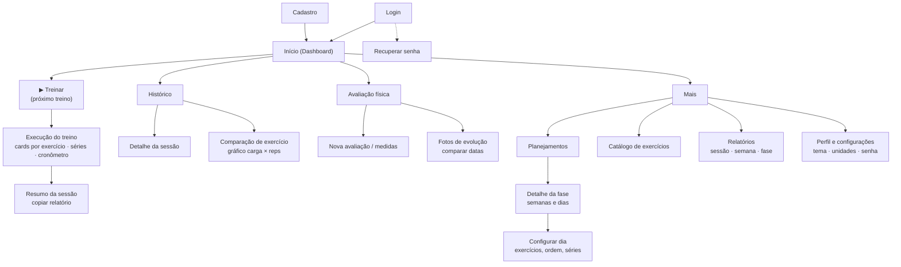
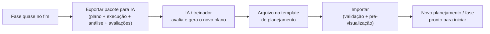

# Gym Work — Análise e Arquitetura

> Documento de proposta para aprovação (seção 15 do prompt mestre).
> Nada além da Etapa 1 será implementado antes da aprovação.

---

## 0. Ponto de partida

O que já existe no repositório (equivale à **Etapa 1** quase concluída e a uma parte pequena da **Etapa 2**):

| Item | Situação |
| --- | --- |
| Backend Spring Boot 4.2 + Java 17, Maven, Flyway, Actuator, Swagger | ✅ pronto |
| Frontend Vue 3 + TS + Vite + Quasar + Pinia + Router + Axios + ESLint/Prettier | ✅ pronto |
| Docker Compose com PostgreSQL 17 | ✅ pronto |
| Cadastro, login e JWT de acesso; `GET /api/users/me` | ✅ pronto (12 testes) |
| Tema escuro | ✅ aplicado junto com este documento |

**Ajustes que esta arquitetura exige no que já existe** (feitos no início da Etapa 2):

1. Trocar os IDs `BIGINT` por **UUID** — a migration `V1` ainda não foi aplicada em nenhum banco real, então ela será reescrita em vez de criar uma `V2`.
2. Tirar o token de acesso do `localStorage` (vulnerável a XSS) e adotar **refresh token em cookie HttpOnly** (seção 5).
3. Adicionar **Testcontainers** para os testes de integração contra PostgreSQL real (o isolamento multiusuário precisa ser testado no banco, não só com mocks).

---

## 1. Ambiguidades identificadas e proposta

Cada item tem uma proposta padrão. Se você concordar, siga com ela; se não, me diga qual mudar.

| # | Ambiguidade | Proposta |
| --- | --- | --- |
| A1 | **Semanas × Dias de treino.** A hierarquia diz `Fases → Semanas → Dias`, mas o exemplo descreve dias fixos por fase (SEG UPPER, TER LOWER A…) repetidos por 8 semanas. | Os **dias de treino pertencem à fase** (modelo semanal). As **semanas** são criadas automaticamente (1..N) e guardam o contexto da semana: data de início, deload, observações. Cada sessão aponta para a semana em que foi feita. Variações por semana, se necessárias, entram depois como "ajuste da semana". |
| A2 | **Planejamento × Fase.** O exemplo "Planejamento: Hipertrofia — Fase 4 / Fase: Fase 4 — Ombros" mistura os dois. | O planejamento é o ciclo maior (ex.: "Hipertrofia 2026") e contém **várias fases em ordem**. A quantidade de semanas fica na **fase**; a do planejamento é a soma das fases. |
| A3 | **Séries planejadas** individuais (pirâmide, top set + back-off) ou configuração única por exercício? | Configuração **por exercício** (séries, faixa de reps, descanso, RIR, carga sugerida), como descrito no item 4.3. Séries com alvos diferentes ficam para uma evolução futura. |
| A4 | **Quantos planejamentos ativos ao mesmo tempo?** | **Um ativo por usuário** (garantido por índice no banco). Os outros ficam como rascunho, concluídos ou arquivados. |
| A5 | **Treino avulso** (fora do planejamento). | Permitido: a sessão pode existir sem dia planejado (ex.: treino extra, viagem). |
| A6 | **"Peso: 100 kg" no relatório semanal** — de onde vem? | Da **avaliação física mais recente dentro da semana**. Para facilitar, haverá um "registro rápido de peso" que cria uma avaliação só com o peso. Se não houver nenhuma, a linha é omitida (nunca inventada). |
| A7 | **Recuperação de senha** precisa enviar e-mail. | Usar SMTP. Em desenvolvimento, o **Mailpit** sobe no Docker Compose e captura os e-mails numa interface web local. Em produção, qualquer SMTP (SES, Brevo, Gmail…). |
| A8 | **Exclusão de conta** "respeitando integridade". | Exige a senha e confirmação explícita. Apaga **todos os dados do usuário** (treinos, avaliações, fotos no storage) numa única transação, em ordem controlada. Como os dados são só dele, não há o que preservar para terceiros. |
| A9 | **Catálogo global de exercícios** — quem mantém? | Exercícios globais vêm de uma **migration de seed** (lista inicial ~60 exercícios). Por enquanto não há perfil de administrador; o usuário cria os exercícios personalizados dele. |
| A10 | **Unidades** (kg/lb, cm/pol). | O banco guarda sempre **kg e cm**. A conversão é feita só na exibição, conforme a preferência do usuário. |
| A11 | **Uso na academia sem internet** estável. | Cada série é salva no servidor assim que registrada. Se a rede cair, o frontend guarda a série numa **fila local** e reenvia ao reconectar. Não é um app offline completo (PWA) — isso pode vir na Etapa 8. *(Feito na Etapa 8: o app instala no celular e abre sem internet; veja as decisões da Etapa 8.)* |
| A12 | **Regras de progressão configuráveis.** | Regra padrão: **dupla progressão** (bater o teto da faixa em todas as séries válidas, com RIR ≥ alvo e sem dor registrada). O usuário pode ajustar por exercício: RIR mínimo, quantas sessões seguidas no teto e incremento de carga sugerido. |
| A13 | **Drop set / rest-pause** contam como séries válidas? | Contam no **volume** como parte da série principal (não como séries extras) e **não entram** na análise de progressão de carga. Aquecimento e ativação não contam em nada. |
| A14 | **Versão do JUnit.** O prompt pede JUnit 5; o Spring Boot 4 traz o JUnit **6**, que mantém a mesma API do 5. | Manter o Boot 4 com JUnit 6 (mesma escrita de testes). A alternativa seria o Boot 3.5, que já está sem suporte gratuito. |

---

## 2. Arquitetura geral



**Princípios:**

- **Organização por funcionalidade** (`training`, `workout`, `assessment`…), não por camada técnica. Cada pacote tem `controller`, `service`, `repository`, `domain` (entidades) e `dto`.
- **Entidades JPA nunca saem da API**: tudo entra e sai por DTOs (records Java), com mapeamento manual (sem MapStruct, para não adicionar dependência fora da stack).
- **Regras de negócio só no backend**. O frontend repete validações apenas para dar feedback rápido.
- **O backend gera os relatórios** (texto e análise). Assim eles são reproduzíveis a partir dos dados salvos e o frontend só exibe, copia ou baixa.
- **Erros padronizados** no formato RFC 9457 (`application/problem+json`), já implementado.
- **Paginação** (`page`, `size`, `sort`) em todas as listagens de histórico.

---

## 3. Modelo de dados

### 3.1 Diagrama entidade-relacionamento



### 3.2 Entidades

Todas as tabelas têm `id UUID` (gerado pela aplicação), `created_at` e `updated_at` (auditoria do Spring Data JPA). As editáveis têm `version` para **lock otimista** — evita que duas abas sobrescrevam a mesma sessão.

**Usuários e segurança**

| Tabela | Campos principais | Observações |
| --- | --- | --- |
| `users` | email (único, minúsculo), password_hash, name, status | BCrypt. |
| `user_profiles` | user_id (PK/FK), height_cm, birth_date, weight_unit (KG/LB), length_unit (CM/IN), theme (DARK/LIGHT/SYSTEM), default_rest_seconds, rest_sound_enabled, timezone | Perfil + configurações pessoais (1:1). |
| `refresh_tokens` | user_id, token_hash, family_id, expires_at, revoked_at, replaced_by_id, user_agent | Guarda só o **hash** do token. |
| `password_reset_tokens` | user_id, token_hash, expires_at, used_at | Uso único, expira em 30 min. |

**Catálogo**

| Tabela | Campos principais | Observações |
| --- | --- | --- |
| `muscle_groups` | code (PK), name, position | Tabela de referência (seed). Cumpre o papel de "ExerciseCategory". O código (CHEST, BACK…) é estável e serve para templates de importação. |
| `exercises` | owner_id (nulo = global), name, search_name, primary_muscle_group, description, instructions, type (COMPOUND/ISOLATION), equipment (BARBELL, DUMBBELL, MACHINE, CABLE, SMITH, BODYWEIGHT, KETTLEBELL, BAND, OTHER), active | Único por (dono, nome, equipamento), sem diferenciar maiúsculas. `search_name` é o nome sem acentos, para a busca. Não é apagado, só desativado. |
| `exercise_secondary_muscles` | exercise_id, muscle_group_id | N:N. |
| `progression_rules` | user_id, exercise_id, min_rir, sessions_at_top, load_increment_kg, enabled | Opcional; sem registro = regra padrão. Criada na Etapa 5, junto com a análise de progressão. |

**Planejamento** (o "plano")

| Tabela | Campos principais | Observações |
| --- | --- | --- |
| `training_plans` | user_id, name, goal (HYPERTROPHY, STRENGTH, FAT_LOSS, MAINTENANCE, OTHER), start_date, expected_end_date, status (DRAFT, ACTIVE, COMPLETED, ARCHIVED), notes | Índice parcial: um ACTIVE por usuário. |
| `training_phases` | plan_id, user_id, name, position, start_date, weeks_count, notes | |
| `training_weeks` | phase_id, user_id, week_number, start_date, is_deload, notes | Geradas automaticamente a partir de `weeks_count`. |
| `workout_days` | phase_id, user_id, name ("UPPER"), day_of_week (opcional), position, notes | |
| `planned_exercises` | workout_day_id, user_id, exercise_id, position, sets, reps_min, reps_max, rest_seconds, suggested_load_kg, target_rir, notes | `CHECK reps_min <= reps_max`, `sets > 0`. |

**Execução** (o que aconteceu de fato)

| Tabela | Campos principais | Observações |
| --- | --- | --- |
| `workout_sessions` | user_id, plan_id?, phase_id?, week_id?, workout_day_id?, status (IN_PROGRESS, COMPLETED), started_at, finished_at, notes + **snapshot**: plan_name, phase_name, week_number, day_name | Índice parcial: no máximo uma IN_PROGRESS por usuário. |
| `session_exercises` | session_id, user_id, exercise_id, planned_exercise_id?, position, status (PENDING, DONE, PARTIAL, SKIPPED, SUBSTITUTED), substituted_by_id?, notes + **snapshot**: exercise_name, equipment, planned_sets, reps_min, reps_max, rest_seconds, target_rir, reference_load_kg | |
| `exercise_sets` | session_exercise_id, user_id, set_number, set_type (WARMUP, ACTIVATION, WORKING, DROP_SET, REST_PAUSE, EXTRA), parent_set_id?, status (COMPLETED, NOT_PERFORMED, INTERRUPTED, SUBSTITUTED), load_kg, reps, rir, rest_seconds, notes, performed_at | Drop set / rest-pause apontam para a série principal (`parent_set_id`). |
| `workout_observations` | user_id, session_id?, session_exercise_id?, exercise_id?, category (PAIN, DISCOMFORT, RECOVERY, SLEEP, ENERGY, EXECUTION_DIFFICULTY, EQUIPMENT_UNAVAILABLE, GENERAL), body_region, body_side (LEFT/RIGHT/BOTH), intensity (0–10), moment (BEFORE/DURING/AFTER), interrupted, text, observed_at | Campos de corpo só para dor/desconforto (validado no backend). |

**Avaliação física** (independente do planejamento)

| Tabela | Campos principais | Observações |
| --- | --- | --- |
| `body_assessments` | user_id, assessed_on, weight_kg?, height_cm?, body_fat_pct?, notes | Todos os valores são opcionais. |
| `body_measurements` | assessment_id, user_id, type (SHOULDERS, CHEST, WAIST, ABDOMEN, ARM_RIGHT, ARM_LEFT, FOREARM_RIGHT, …, CALF_LEFT), value_cm | Uma linha por medida informada — medida não informada simplesmente não existe. |
| `progress_photos` | assessment_id, user_id, position (FRONT, RIGHT, LEFT, BACK, OTHER), storage_key, content_type, size_bytes, width, height | O arquivo fica no storage; o banco guarda só a referência. |

### 3.3 Decisões principais

1. **Snapshot em vez de versionar o plano.** Ao iniciar a sessão, os dados do plano (nome do exercício, faixa de reps, descanso, RIR, carga de referência) são **copiados** para `session_exercises`. Editar, reordenar ou apagar o plano depois não altera nada do histórico. É mais simples que versionar o plano inteiro e cobre a regra "planejamento não é execução".
2. **Histórico nunca é apagado por cascata.** As FKs da execução para o plano são `ON DELETE SET NULL` (o snapshot mantém os nomes) e para `exercises` são `RESTRICT` (exercício com histórico só pode ser desativado). Cascata só existe dentro de um mesmo agregado (ex.: apagar uma sessão apaga as séries dela).
3. **`user_id` em todas as tabelas do usuário**, mesmo nas filhas. Isso deixa toda consulta filtrar direto pelo dono, sem joins, e permite a garantia no banco descrita na seção 4.
4. **UUID como ID** em todas as entidades: impede adivinhar IDs sequenciais.
5. **Índices** nas consultas frequentes: `(user_id, started_at DESC)` em sessões, `(user_id, exercise_id, performed_at)` em séries para o histórico por exercício, `(user_id, assessed_on DESC)` em avaliações, além das FKs.
6. **Medidas em linhas** (`body_measurements`) em vez de 14 colunas nulas: facilita comparar e adicionar novas medidas sem migration.

---

## 4. Isolamento multiusuário

Defesa em três camadas:

1. **Serviço** — todo acesso usa o usuário autenticado (vindo do JWT) e busca com `findByIdAndUserId(id, currentUserId)`. Recurso de outro usuário retorna **404**, nunca 403, para não revelar que o UUID existe. Não existe nenhum método de repositório que busque só por `id` em entidades do usuário.
2. **Banco** — as tabelas filhas referenciam o pai por **FK composta** `(parent_id, user_id)`. Assim, o PostgreSQL rejeita, por exemplo, uma série de um usuário pendurada na sessão de outro, mesmo se houver bug no código.
3. **Testes** — uma suíte de integração (Testcontainers) cria dois usuários e verifica que o usuário B recebe 404 em **todos** os endpoints de leitura, edição, exclusão e exportação de recursos do usuário A.

**Arquivos (fotos):** nunca são servidos por URL pública. A API gera uma **URL assinada de curta duração** (HMAC + expiração de 5 min) só para o dono da foto. Isso funciona com ``, que não envia o header `Authorization`, e é o mesmo modelo de URL pré-assinada do S3 — a troca para S3 depois é só uma nova implementação de `StorageService`.

**Logs:** senhas, tokens e o header `Authorization` nunca são logados.

---

## 5. Autenticação



- **Access token**: JWT HS256, 15 minutos, guardado só em memória. Ao recarregar a página, o frontend chama `/refresh` e recupera a sessão.
- **Refresh token**: valor aleatório de 256 bits, guardado no banco como hash SHA-256, enviado em cookie `HttpOnly; Secure; SameSite=Strict; Path=/api/auth`. JavaScript não consegue lê-lo, o que protege contra XSS.
- **Rotação e revogação**: cada uso gera um novo refresh. Reuso de um token antigo revoga a família inteira. Trocar a senha ou excluir a conta revoga todos os tokens do usuário.
- **Várias abas** (definido na Etapa 2): o frontend serializa a renovação entre abas com a Web Locks API, e o backend tolera por 10 segundos o reuso de um token recém-trocado (responde 401 sem revogar a família). Fora dessa janela, reuso continua sendo tratado como roubo.
- **Perfis** (definido na Etapa 2): `dev` (padrão, valores locais) e `prod` (exige variáveis de ambiente, cookie `Secure`, Swagger desligado).
- **CSRF**: como o cookie só vai para `/api/auth/*` e é `SameSite=Strict`, e os demais endpoints usam header `Authorization`, não há superfície de CSRF. Em produção, frontend e API devem ficar no mesmo site (ex.: `app.dominio.com` e `api.dominio.com`).
- **Recuperação de senha**: `forgot-password` sempre responde 204 (não revela se o e-mail existe) e envia um link com token de uso único.
- **CORS** por ambiente via `CORS_ALLOWED_ORIGINS`, com `allowCredentials` para o cookie.

---

## 6. Endpoints REST

Prefixo `/api`. Todos exigem JWT, exceto os marcados com 🔓. Listagens são paginadas.

**Autenticação e conta**

| Método | Rota | Descrição |
| --- | --- | --- |
| POST 🔓 | `/auth/register` | Cadastro |
| POST 🔓 | `/auth/login` | Login |
| POST 🔓 | `/auth/refresh` | Renova o token (cookie) |
| POST | `/auth/logout` | Logout |
| POST 🔓 | `/auth/forgot-password` | Envia e-mail de recuperação |
| POST 🔓 | `/auth/reset-password` | Define nova senha com o token |
| GET / PUT | `/me` | Perfil |
| GET / PUT | `/me/settings` | Unidades, tema, descanso padrão, som |
| PUT | `/me/password` | Alterar senha (pede a atual) |
| DELETE | `/me` | Excluir conta (pede a senha) |

**Catálogo e regras**

| Método | Rota | Descrição |
| --- | --- | --- |
| GET | `/muscle-groups` | Grupos musculares |
| GET | `/exercises?search=&muscleGroup=&equipment=&scope=all\|global\|mine` | Busca no catálogo |
| POST | `/exercises` | Cria exercício personalizado |
| GET / PUT | `/exercises/{id}` | Detalhe / edição (só personalizados) |
| PATCH | `/exercises/{id}/active` | Ativar ou desativar |
| GET / PUT | `/exercises/{id}/progression-rule` | Regra de progressão do usuário |

**Planejamento**

| Método | Rota | Descrição |
| --- | --- | --- |
| GET / POST | `/plans` | Listar / criar |
| GET / PUT / DELETE | `/plans/{id}` | Detalhe (com fases) / editar / excluir |
| POST | `/plans/{id}/activate` | Torna ativo (desativa o anterior) |
| POST | `/plans/{id}/duplicate` | Duplica |
| POST | `/plans/{id}/phases` | Cria fase (gera as semanas) |
| GET / PUT / DELETE | `/phases/{id}` | Detalhe (dias, exercícios, semanas) / editar / excluir |
| GET | `/days/{id}` | Dia com os exercícios (adicionado na Etapa 3) |
| POST | `/phases/{id}/duplicate` | Cria nova fase a partir desta |
| PUT | `/weeks/{id}` | Deload, observações |
| POST | `/phases/{id}/days` | Cria dia de treino |
| PUT / DELETE | `/days/{id}` | Editar / excluir dia |
| PUT | `/phases/{id}/days/order` | Reordenar dias |
| POST | `/days/{id}/exercises` | Adiciona exercício ao dia |
| PUT / DELETE | `/planned-exercises/{id}` | Editar (séries, reps, descanso…) / remover |
| POST | `/planned-exercises/{id}/replace` | Substituir exercício mantendo a configuração |
| PUT | `/days/{id}/exercises/order` | Reordenar exercícios |

**Execução**

| Método | Rota | Descrição |
| --- | --- | --- |
| GET | `/sessions/start-options` | Tela Treinar: sessão em andamento ou dias da fase atual (adicionado na Etapa 4) |
| POST | `/sessions` | Inicia sessão (`workoutDayId`, `weekId`, ou avulsa) |
| GET | `/sessions/current` | Sessão em andamento (recuperação) |
| GET | `/sessions?from=&to=&page=` | Histórico |
| GET | `/sessions/{id}` | Detalhe com exercícios, séries e última execução de cada um |
| POST | `/sessions/{id}/finish` | Finaliza (mesmo incompleta) |
| DELETE | `/sessions/{id}` | Descarta sessão (com confirmação) |
| POST | `/sessions/{id}/exercises` | Adiciona exercício extra |
| POST | `/session-exercises/{id}/skip` / `unskip` | Pula exercício / desfaz |
| POST | `/session-exercises/{id}/substitute` | Substitui exercício |
| PATCH | `/session-exercises/{id}` | Observações / ordem |
| POST | `/session-exercises/{id}/sets` | Registra série |
| PUT / DELETE | `/sets/{id}` | Corrige / remove série |
| GET / POST | `/observations` | Observações (dor, sono, energia…) |
| PUT / DELETE | `/observations/{id}` | |

**Evolução**

| Método | Rota | Descrição |
| --- | --- | --- |
| GET | `/exercises/{id}/history?page=` | Histórico por sessão |
| GET | `/exercises/{id}/summary` | Última carga/reps, melhor desempenho |
| GET | `/exercises/{id}/progress?groupBy=SESSION\|WEEK\|PHASE` | Dados do gráfico |
| GET | `/progression?phaseId=&weeks=` | Exercícios em progresso, estáveis e em queda, com sugestão |
| GET | `/progression/volume?weeks=` | Séries por grupo muscular e frequência por semana (adicionado na Etapa 5) |
| GET / PUT / DELETE | `/exercises/{id}/progression-rule` | Regra de progressão (DELETE volta ao padrão) |
| GET | `/dashboard` | Dados agregados da tela inicial (implementado na Etapa 8) |

**Avaliação física**

| Método | Rota | Descrição |
| --- | --- | --- |
| GET / POST | `/assessments` | Listar / criar (medidas inclusas) |
| GET / PUT / DELETE | `/assessments/{id}` | |
| GET | `/assessments/compare?a=&b=` | Comparativo entre duas datas |
| GET | `/assessments/trend` | Peso, gordura e medidas para gráficos (adicionado na Etapa 6) |
| PATCH | `/photos/{id}` | Muda a posição da foto (adicionado na Etapa 6) |
| POST | `/assessments/{id}/photos` | Upload (multipart; JPEG/PNG/WebP, até 10 MB) |
| GET | `/photos/{id}/url` | URL assinada temporária |
| GET 🔓 | `/files/{token}` | Entrega o arquivo se a assinatura for válida |
| DELETE | `/photos/{id}` | |

**Relatórios**

| Método | Rota | Descrição |
| --- | --- | --- |
| GET | `/reports/sessions/{id}` | Texto da sessão |
| GET | `/reports/weeks/{id}` | Texto da semana |
| GET | `/reports/phases/{id}` | Texto da fase |
| GET | `/reports/{tipo}/{id}/analysis` | Resumo estruturado (JSON) |
| GET | `/reports/phases/{id}/ai-package` | Pacote para IA (`?format=md|json`) — adicionado na Etapa 7 |
| GET | `/plans/{id}/template` | Planejamento no template `gymwork.plan/v1` — adicionado na Etapa 7 |
| GET | `/phases/{id}/template` | Uma fase no template — adicionado na Etapa 7 |
| POST | `/plans/import/preview` | Valida o JSON `gymwork.plan/v1` e mostra o que será criado, sem gravar — Etapa 9 |
| POST | `/plans/import` | Importa: novo planejamento em rascunho, ou fases no fim de `planId` — Etapa 9 |

Os relatórios de texto respondem `text/plain` (copiar) ou, com `?download=true`, como arquivo `.txt`. PDF e CSV entram como novos formatos da mesma rota (`?format=pdf|csv`), reutilizando o mesmo modelo de dados do relatório.

---

## 7. Estrutura de pastas

Dois repositórios independentes: [gym-work-back](https://github.com/willianguimaraes/gym-work-back) e [gym-work-front](https://github.com/willianguimaraes/gym-work-front).

```
gym-work-back/
├── src/main/java/com/gymwork/api/
│   ├── config/          # Security, CORS, OpenAPI, Jackson, auditoria
│   ├── security/        # JWT, refresh token, CurrentUser, filtros
│   ├── user/            # cadastro, perfil, configurações, exclusão de conta
│   ├── exercise/        # catálogo, grupos musculares, regras de progressão
│   ├── training/        # planos, fases, semanas, dias, exercícios planejados
│   ├── workout/         # sessões, exercícios executados, séries, observações
│   ├── progression/     # análise de progressão, volume, histórico por exercício
│   ├── assessment/      # avaliações, medidas, fotos
│   ├── report/          # geração de texto, análise, exportação
│   ├── storage/         # StorageService (local; S3 depois), URLs assinadas
│   ├── mail/            # envio de e-mails
│   └── common/          # exceções, ProblemDetail, paginação, entidade base
│       (cada módulo: controller/ service/ repository/ domain/ dto/)
├── src/main/resources/db/migration/   # V1__..., V2__...
├── docs/ARQUITETURA.md
├── docker-compose.yml   # PostgreSQL + Mailpit
├── .env.example
└── README.md

gym-work-front/
├── src/
│   ├── assets/
│   ├── boot/            # inicialização (axios, tema, sessão)
│   ├── components/      # componentes reutilizáveis, por módulo
│   │   ├── workout/     # SetRow, ExerciseCard, RestTimer…
│   │   └── …
│   ├── composables/     # useRestTimer, useUnits, useOfflineQueue…
│   ├── layouts/
│   ├── pages/
│   ├── router/
│   ├── services/        # um arquivo por recurso da API
│   ├── stores/          # Pinia por módulo
│   ├── types/           # tipos espelhando os DTOs
│   └── utils/
├── .env.example
└── README.md
```

---

## 8. Fluxo das telas



**Navegação inferior** (alcance do polegar): **Início · Histórico · ▶ Treinar · Avaliação · Mais**. O botão central "Treinar" abre a sessão em andamento ou inicia o próximo treino previsto.

**Tela de execução** (a mais importante):
- Um card por exercício: nome, carga de referência, faixa de reps, descanso e a **última execução** ("Última: 45 kg · 8/7/7/6").
- Cada série é uma linha com carga e reps **já preenchidas com a última execução** — na maioria das vezes basta ajustar e tocar ✓.
- Ao concluir uma série, o **cronômetro de descanso** começa sozinho (com som e vibração opcionais).
- Ações no card: adicionar série, aquecimento, pular, substituir, observação.
- Barra de progresso no topo ("12 de 20 séries"). Cada série é salva na hora, com indicação visual de salvo/pendente.

---

## 9. Regras de negócio críticas (no backend)

| Regra | Como será garantida |
| --- | --- |
| Planejamento ≠ execução; mudar o plano não altera o histórico | Snapshot ao iniciar a sessão; FK `SET NULL`/`RESTRICT` |
| Treino incompleto é preservado | Finalizar não exige séries; status PARTIAL/SKIPPED |
| Ausência de registro ≠ série feita | Série só existe se foi registrada; séries não feitas têm status explícito |
| Aquecimento/ativação fora do volume e da progressão | Filtro por `set_type` num único lugar (`VolumeCalculator`) |
| Progressão considera **todas** as séries válidas | `ProgressionAnalyzer`: só sugere aumento se todas as séries válidas atingiram o teto, RIR ≥ alvo |
| Treino incompleto não é regressão | Exercício sem todas as séries feitas é classificado como "incompleto", não "queda" |
| Dor bloqueia sugestão de aumento | Observação de dor/desconforto no exercício (na sessão analisada) suspende a sugestão |
| Não comparar equipamentos diferentes | Comparações agrupam por `exercise_id` (cada exercício já tem um equipamento) |
| Sugestões são só informativas | A API devolve a sugestão; nada muda o plano sem ação do usuário |
| Sem diagnóstico médico | Textos fixos e neutros; nenhuma inferência sobre lesão |
| Relatórios reproduzíveis | Gerados só a partir de dados persistidos; nada inventado (campo vazio é omitido) |
| Uma sessão em andamento por usuário | Índice único parcial no banco |
| Isolamento entre usuários | Seção 4 |

---

## 10. Plano de execução por etapas

Cada etapa termina com: build e testes passando, verificação no navegador em tamanho de celular, e o relatório pedido na seção 14 do prompt.

| Etapa | Entregas | Testes principais |
| --- | --- | --- |
| **1 — Fundação** ✅ | Projetos, Docker, Flyway, Swagger, tema escuro | Build, lint, contexto |
| **2 — Usuários e segurança** ✅ | IDs UUID; refresh token com rotação; logout; recuperação e troca de senha (Mailpit); perfil e configurações (unidades, tema); exclusão de conta; `CurrentUser` e base de isolamento; Testcontainers | Autenticação, rotação/reuso de refresh, isolamento |
| **3 — Catálogo e planejamento** ✅ | Seed de exercícios; exercícios personalizados; planos, fases, semanas, dias, exercícios planejados; reordenar, substituir e duplicar; telas de planejamento | Criação, duplicação, isolamento |
| **4 — Execução** ✅ | Sessões com snapshot; registro de séries (tipos e status); pular/substituir; observações; cronômetro; recuperação de sessão; fila offline; tela mobile | Início/fim, séries, sessão incompleta, recuperação |
| **5 — Evolução e progressão** ✅ | Histórico por exercício; gráficos; volume por grupo muscular; análise de progressão com regras configuráveis | Cálculo de volume e de progressão (casos de borda) |
| **6 — Avaliação física** ✅ | Avaliações, medidas, fotos com storage privado e URL assinada, comparativos | Avaliações, upload (tipo/tamanho), acesso às fotos |
| **7 — Relatórios** ✅ | Texto de sessão/semana/fase no formato exato; copiar e baixar TXT; resumo de análise; PDF e CSV; **pacote de exportação para IA** (seção 11) | Geração de texto (snapshot de saída), exportação |
| **8 — Dashboard e refinamento** ✅ | Dashboard com indicadores e gráficos; ajustes de usabilidade; testes de integração ponta a ponta; documentação final | Integração geral |
| **9 — Importação de planejamento** ✅ | Importação do JSON `gymwork.plan/v1`; validação com pré-visualização; exercícios casados com o catálogo; criação do plano (ou de fases) a partir do arquivo (seção 11) | Validação do template, importação, isolamento |

**Decisões de implementação da Etapa 3** (sem mudar nenhuma das ambiguidades A1–A14):

- Ao ativar um planejamento, o que estava ativo passa a **COMPLETED**. O status também pode ser trocado na edição (rascunho, concluído, arquivado).
- Duplicar um planejamento cria um **rascunho sem datas**, com as mesmas fases, semanas (marcações de deload), dias e exercícios. "Criar fase a partir desta" adiciona a cópia no fim do mesmo planejamento.
- Mudar a duração da fase cria ou remove semanas **no fim**. As datas das semanas são recalculadas a partir da data de início da fase (sem data de início, as semanas ficam sem data).
- A reordenação recebe a lista completa de IDs na nova ordem. A API recusa uma lista com item faltando, repetido ou de outro dia/fase.
- Foi adicionado `GET /days/{id}`, usado pela tela de configuração do dia.
- A regra de progressão por exercício (`/exercises/{id}/progression-rule`) ficou para a Etapa 5, junto com a análise que a usa.
- Navegação inferior por enquanto: **Início · Mais**. Histórico, Treinar e Avaliação entram nas etapas 4 a 6.

**Decisões de implementação da Etapa 4** (sem mudar nenhuma das ambiguidades A1–A14):

- A sessão copia do plano o nome do plano, da fase e do dia, o número da semana, se é deload, e, por exercício, nome, equipamento, séries, faixa de reps, descanso, RIR e carga de referência. As referências ao plano usam `ON DELETE SET NULL` só na coluna do plano (PostgreSQL 15+), preservando o `user_id` da FK composta.
- Sem `weekId`, a semana é escolhida pela data de hoje no fuso do usuário (preferência do perfil), quando a fase tem data de início.
- Status do exercício: PENDING/PARTIAL/DONE são calculados pelas séries válidas concluídas (trabalho e adicionais); drop set e rest-pause ficam presos à série principal e não contam como séries extras (A13); aquecimento e ativação não contam. Registrar uma série desfaz o "pular"; "substituído" é definitivo (o novo exercício entra logo depois com a mesma configuração).
- Exercício que ficou sem séries numa sessão finalizada aparece como "não feito"; nenhuma série é criada automaticamente (ausência de registro ≠ série feita).
- **Fila offline (A11):** cada série leva um `clientId` gerado no aparelho; reenviar o mesmo `clientId` devolve o registro existente. O app guarda a fila no navegador e reenvia quando a API volta (evento `online` e nova tentativa a cada 20 s). Ela cobre queda de rede com o app aberto; reabrir o app sem internet depende do modo offline completo (PWA), feito na Etapa 8.
- Os endpoints de série devolvem o exercício inteiro atualizado (séries e status), para a tela se atualizar com uma resposta só.
- Cronômetro de descanso no app: guarda o horário de término, então sobrevive a recarregar a página; som (opcional, pela preferência) e vibração ao terminar.
- Observações: região e lado do corpo só para dor/desconforto (regra no backend e `CHECK` no banco); observação geral exige texto. Elas podem ser da sessão, de um exercício da sessão ou avulsas.
- Navegação inferior: **Início · Histórico · Treinar · Mais**. Avaliação física entra na Etapa 6.

**Decisões de implementação da Etapa 5** (sem mudar nenhuma das ambiguidades A1–A14):

- Só sessões **finalizadas** entram na evolução; cada exercício do catálogo tem um equipamento, então cargas de equipamentos diferentes nunca são comparadas.
- **Tendência** (`ProgressionAnalyzer`, único lugar das regras): compara a última execução completa com a anterior, fora as semanas de deload. Maior carga → em progresso; mesma carga → média de reps nas séries com a maior carga (mais = progresso, igual = estável, menos = queda); carga menor → queda. Se a faixa de reps mudou (nova fase), compara pelo 1RM estimado (Epley, ±2%). Execução incompleta (menos séries que o planejado, série interrompida/não feita, pulado ou substituído) → "incompleto", nunca "queda".
- **Sugestão** (dupla progressão, A12): todas as séries válidas no teto da faixa, RIR ≥ mínimo (regra ou RIR alvo do plano) e N sessões seguidas no teto com a mesma carga → "avaliar aumento" de +2,5 kg (ou o incremento da regra). Dor no exercício, ou desconforto com intensidade ≥ 5 ou que interrompeu, suspende a sugestão. Queda gera "rever recuperação", sem mudar nada no plano.
- Volume: séries válidas contam para o grupo principal do exercício e, à parte, para os secundários (sem pesos fracionados); volume de carga = kg × reps das séries válidas mais drop sets e rest-pause (A13). Semanas de segunda a domingo no fuso do usuário.
- Gráficos com **Chart.js 4** (dependência prevista para esta etapa).

**Decisões de implementação da Etapa 6** (sem mudar nenhuma das ambiguidades A1–A14):

- **Storage:** `StorageService` com implementação em disco (`STORAGE_DIR`, fora de qualquer pasta servida). A chave do arquivo é aleatória (`photos/{uuid}.jpg`), sem o ID do usuário. Trocar por S3 é uma nova implementação da interface.
- **URL assinada:** `/api/files/{token}`, com token = chave + vencimento assinados com HMAC-SHA256 (`STORAGE_URL_SECRET`), válido por 5 minutos. A resposta de cada foto já traz a URL; o app pede outra se ela vencer. Token inválido, vencido ou de arquivo apagado → 404.
- **Validação do arquivo:** tipo real pelos primeiros bytes (JPEG, PNG ou WebP), até 10 MB e até 12 fotos por avaliação. Nome e Content-Type enviados são ignorados.
- **Privacidade:** o app reduz a foto (máx. 1600 px) e a regrava em JPEG antes do envio, o que remove os metadados EXIF, inclusive a localização GPS. Uploads feitos direto na API (fora do app) guardam o arquivo como veio.
- **Arquivos e banco coerentes:** arquivos de registros apagados somem só depois do commit; um arquivo gravado numa transação que falhou é removido no rollback. A exclusão de conta apaga os arquivos.
- **Comparativo:** a diferença só aparece quando o valor existe nas duas avaliações; nada é estimado (sem IMC ou valores derivados). As fotos são pareadas por posição.
- Registro rápido de peso (A6) = avaliação só com o peso. A data não pode estar no futuro (fuso do usuário).
- Navegação inferior completa: **Início · Histórico · Treinar · Avaliação · Mais**.

**Decisões de implementação da Etapa 7** (sem mudar nenhuma das ambiguidades A1–A14; formato aprovado antes da implementação):

- **Um modelo, vários formatos:** `ReportLoader` monta o relatório (sessão, semana ou fase) só com dados registrados; texto, PDF, CSV, análise e pacote para IA saem dele.
- **Texto no formato da seção 5:** mesma carga → `45 kg | 8/8/7/6`; cargas diferentes → `45 kg | 8/8 · 40 kg | 7/6`; série não feita → `x` (inclusive as planejadas que não chegaram a ser registradas, depois de finalizada a sessão); pulado → `não realizado`; substituição → `Remada baixa → Remada articulada: …`; drop set e rest-pause → `8+4`; sem carga → só as repetições. Aquecimento e ativação ficam fora. O peso da semana vem da avaliação mais recente dentro dela (A6) e some se não houver.
- **Dias da semana:** os dias planejados aparecem na ordem do plano; um dia sem sessão vira "Não realizado" só depois que a data dele passou (semana em andamento não acusa falta). Sessões fora do plano da fase entram no fim da semana. O relatório da fase lista as semanas já iniciadas ou com treino.
- **Cargas no texto e no PDF** seguem a unidade do perfil (kg ou lb); **CSV e pacote para IA usam sempre kg**. CSV com `;`, vírgula decimal e BOM UTF-8 (abre direto no Excel em português), uma linha por série, com proteção contra fórmulas.
- **PDF** com OpenPDF 2.0.5 (a última linha compilada para Java 17) e fontes padrão do PDF; a seta da substituição vira `->`.
- **Análise:** usa as regras da Etapa 5. O histórico considerado é o da fase até o fim do período (ou as últimas 26 semanas em treino avulso). Para cada exercício, compara a primeira e a última execução do período (ou a anterior ao período, se houver só uma).
- **Template `gymwork.plan/v1`** e **pacote `gymwork.ai-package/v1`** conforme a seção 11. Avaliações físicas do pacote incluem as feitas até 14 dias antes do início da fase, como referência.
- Telas: **Mais → Relatórios** (planejamento, fases e semanas), menu da sessão ("Relatório"), menu da fase ("Relatório da fase", "Pacote para IA") e do planejamento ("Exportar (JSON)").

**Decisões de implementação da Etapa 8** (sem mudar nenhuma das ambiguidades A1–A14):

- **Dashboard** (`GET /dashboard`): uma chamada só, montada com os serviços existentes (nenhuma regra nova). Ordem na tela: o treino de hoje (em andamento, ou o próximo, com botão para começar), plano/fase/semana, três indicadores (treinos na semana, peso com a diferença para o anterior, exercícios em progresso/estáveis/em queda), a lista por tendência, e os gráficos de carga, frequência, corpo (peso e medidas) e séries por grupo muscular, depois os últimos treinos e as observações recentes. Análise e volume das **últimas 8 semanas**.
- **Próximo treino:** com dias da semana definidos no plano, o próximo dia agendado a partir de hoje (o de hoje, se ainda não foi feito); sem dias definidos, o dia seguinte ao último feito, em rodízio.
- **Gráfico de carga:** os exercícios mais feitos no período; maior carga por sessão e 1RM estimado (só como indicador).
- **PWA** (`vite-plugin-pwa`): instalável (manifesto, ícones) e abre sem internet. O service worker guarda só os arquivos do app; **a API nunca é cacheada** (dados pessoais e autenticação). Versão nova é avisada com "Atualizar", sem recarregar no meio de um treino.
- **Abrir sem internet:** se a sessão não puder ser confirmada por falta de rede (e não por sessão inválida), o app entra em modo sem conexão com o último usuário (só nome e e-mail ficam no aparelho, nunca o token), usa as preferências salvas e o treino em andamento guardado, e reconecta sozinho (evento `online` e a cada 30 s). Começar um treino novo continua exigindo a API.
- **Limite de tentativas** (`AuthRateLimiter`, em memória): login com 10 senhas erradas por conta e IP (50 por IP) a cada 15 min, recuperação de senha com 5 pedidos por e-mail e IP (20 por IP), cadastro com 30 por IP por hora. Responde **429** com `Retry-After`. Com várias instâncias da API, trocar por armazenamento compartilhado.
- O "voltar" de um exercício aberto pela Evolução ou pelo Início volta para lá (antes ia para o catálogo).
- **Testes:** jornada completa de ponta a ponta (cadastro → plano → treino com série reenviada → avaliação → relatórios → dashboard → exclusão da conta, conferindo no banco que nada do usuário sobrou); dashboard; próximo treino; limite de tentativas. No frontend, **Vitest** cobre unidades, erros de rede, nome dos downloads, a fila de séries offline e o modo sem conexão.

**Decisões de implementação da Etapa 9** (sem mudar nenhuma das ambiguidades A1–A14; formato aprovado antes da Etapa 7):

- **Entrada:** o texto do arquivo ou colado do chat (`content`), não um JSON já interpretado, para a API apontar erros de sintaxe com linha e coluna. Texto em volta e cercas ```` ```json ```` são ignorados. Também aceita números como texto (`"4"`), vírgula decimal (`"42,5"`), enums em minúsculas e dias da semana em português; carga com mais de 2 casas é arredondada (com aviso).
- **Validação** (`PlanTemplateReader`, sem acessar o banco): os mesmos limites do cadastro manual, mais um teto por arquivo (12 fases, 14 dias por fase, 40 exercícios por dia, 200 mil caracteres). Todos os problemas voltam de uma vez, com o caminho no JSON e a localização em palavras ("Fase 1 › Dia 2 (LOWER) › Exercício 3"). Campos desconhecidos, dias sem exercício e deload repetido viram **avisos**, que não impedem a importação.
- **Exercícios:** o nome é comparado com o catálogo do usuário (globais e personalizados ativos) sem acentos, maiúsculas ou espaços extras. Um igual → usado direto; mais de um (equipamentos diferentes) → o usuário escolhe; nenhum → até 5 parecidos (palavras em comum ou erro de digitação), busca no catálogo ou cadastro rápido de um personalizado. A escolha vai na confirmação (`exercises`: nome no arquivo → ID) e pode trocar também um nome que já tinha casado. Personalizados de outro usuário nunca aparecem nem são aceitos.
- **Pré-visualizar e confirmar** usam a mesma análise; a confirmação valida tudo de novo e recusa (400, com os problemas) se algo estiver pendente.
- **Destino:** por padrão, um **planejamento novo em rascunho**, sem datas. Com `planId`, as fases entram **no fim** daquele planejamento, e o nome e o objetivo do arquivo são ignorados (com aviso). Nada que já existe é alterado. O botão "Importar a resposta da IA", na aba Pacote para IA, já abre a importação apontando para o planejamento da fase.
- Telas: **Planejamentos → Importar JSON**, menu do planejamento ("Importar fases (JSON)") e aba Pacote para IA do relatório da fase. Com erros, "Copiar problemas para a IA" monta um texto para colar no chat pedindo a correção.
- **Testes:** leitura e validação do template (inclusive respostas típicas de chat e JSON quebrado), semelhança de nomes, e a importação de ponta a ponta (pré-visualização sem gravar, escolha de exercício, ida e volta exportar → importar, fases em plano existente, nome ambíguo, isolamento entre usuários).

**Dependências novas propostas** (todas compatíveis com Java 17):

| Onde | Biblioteca | Para quê | Etapa |
| --- | --- | --- | --- |
| Backend (teste) | Testcontainers (PostgreSQL) | Testes de integração com banco real | 2 |
| Backend | `spring-boot-starter-mail` | Recuperação de senha | 2 |
| Docker | Mailpit | Captura de e-mails em dev | 2 |
| Frontend | Biblioteca de gráficos (ECharts ou Chart.js) | Gráficos de evolução | 5 |
| Backend | OpenPDF 2.0.5 | Exportação PDF | 7 |
| Frontend | `vite-plugin-pwa` 2.0 | App instalável e offline (service worker) | 8 |
| Frontend (teste) | Vitest 5.1 + jsdom | Testes unitários do frontend | 8 |

---

## 11. Ciclo com IA: exportar evolução e importar o próximo planejamento

> Requisito incluído depois da primeira versão deste documento. O formato abaixo foi aprovado antes da Etapa 7. A exportação (Etapa 7) e a importação (Etapa 9) estão implementadas com o mesmo template, por enquanto só em JSON.

**Objetivo:** quando uma fase estiver terminando, exportar tudo o que aconteceu para uma IA (ou treinador) avaliar a evolução e montar o próximo treino; depois, importar esse novo treino no sistema sem cadastrar tudo à mão.



**Ideia central — um único formato de planejamento.** O mesmo template serve para três coisas:

1. **Exportar** o planejamento atual (parte do pacote para a IA, para ela entender o ponto de partida).
2. **Instruir a IA**: o pacote leva o template e um exemplo, pedindo que a resposta venha nesse formato.
3. **Importar** o plano devolvido pela IA.

Assim, o que sai do sistema e o que volta para ele falam a mesma língua, e a validação da importação é a mesma regra usada no cadastro manual.

**Pacote de exportação para IA** (Etapa 7):
- Planejamento da fase (no template).
- Execução semana a semana: cargas e repetições por série, séries não feitas, substituições.
- Resumo de análise: exercícios que evoluíram, estagnaram ou caíram; volume por grupo muscular; frequência.
- Observações de dor e desconforto, sono e energia.
- Avaliações físicas do período (peso e medidas).
- Um texto de instrução (prompt) explicando o objetivo e o formato de resposta esperado.
- Formatos candidatos: texto/Markdown (para colar no chat da IA) e JSON (mais preciso).

**Importação de planejamento** (Etapa 9):
- Formato decidido: **JSON no template `gymwork.plan/v1`** (o mesmo da exportação). A planilha pode vir depois, com as mesmas colunas.
- Fluxo: enviar arquivo → validar → **pré-visualizar** o plano montado e os problemas encontrados → confirmar.
- Exercícios citados pelo nome são casados com o catálogo; os não encontrados aparecem na pré-visualização para o usuário escolher um existente ou criar um personalizado.
- Nunca altera planos existentes: a importação sempre cria um plano ou fase nova (rascunho).

**Template `gymwork.plan/v1`** (cargas em kg; exercícios pelo nome do catálogo; campos sem valor = `null`; limites iguais aos do cadastro manual: séries 1–20, reps 1–100 com `repsMin ≤ repsMax`, descanso 0–900 s, RIR 0–10, semanas 1–52):

```json
{
  "format": "gymwork.plan/v1",
  "plan": { "name": "Hipertrofia 2027", "goal": "HYPERTROPHY", "notes": null },
  "phases": [{
    "name": "Fase 5 — Volume", "weeks": 8, "deloadWeeks": [8], "notes": null,
    "days": [{
      "name": "UPPER", "dayOfWeek": "MONDAY", "notes": null,
      "exercises": [{
        "exercise": "Supino inclinado máquina",
        "sets": 4, "repsMin": 6, "repsMax": 10,
        "restSeconds": 120, "targetRir": 2, "suggestedLoadKg": 45, "notes": null
      }]
    }]
  }]
}
```

**Pacote para IA** (`/reports/phases/{id}/ai-package`): Markdown para colar no chat (ou JSON `gymwork.ai-package/v1` com os mesmos dados), com 1. instruções, 2. contexto, 3. plano atual no template e a descrição dos campos, 4. execução semana a semana no formato de texto, 5. análise, 6. desconfortos e observações, 7. avaliações físicas (tabela e diferença entre a primeira e a última), 8. nomes do catálogo agrupados por músculo.

**Impacto no que vem antes:** o modelo de planejamento da Etapa 3 já é desenhado pensando nesse template (nomes estáveis de campos, enums documentados), para que a exportação e a importação não exijam mudanças no banco depois.
